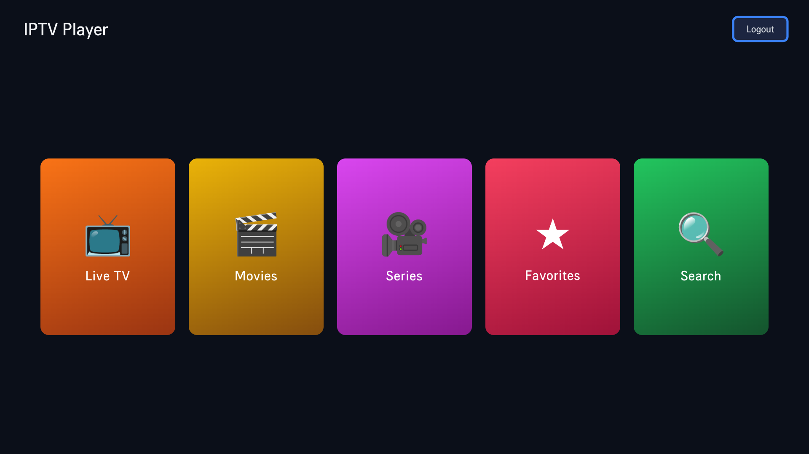
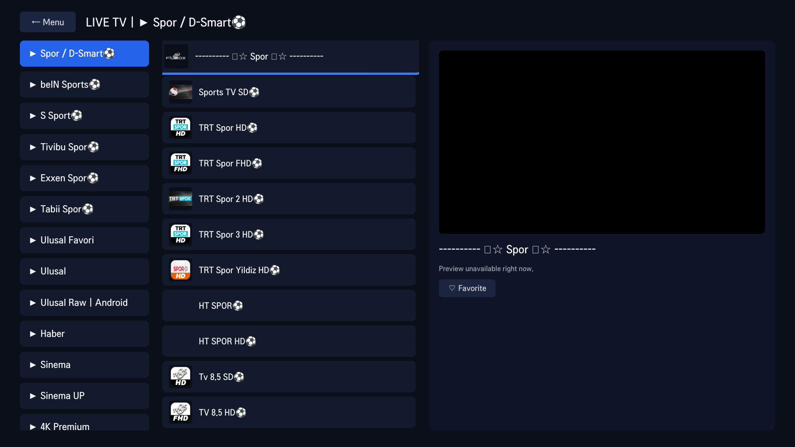

# IPTV Player for LG webOS TV

A custom IPTV player app for LG webOS Smart TVs, built with plain HTML/CSS/JavaScript
(no frameworks, no build step). It connects to any **Xtream Codes**-compatible IPTV
provider (server URL + username + password) and lets you browse and watch Live TV,
Movies, and Series directly from your TV's remote.

## Screenshots

| Main menu | Live TV browsing with preview |
|---|---|
|  |  |

## Features

- **Main menu** — Live TV, Movies, Series, Favorites, and Search as large,
  remote-friendly tiles.
- **Category browsing** — a three-column layout: categories on the left, the
  channel/movie/series list in the middle, and a live preview panel on the right.
- **Live preview** — focus a channel for a moment and it starts playing in the small
  preview box automatically. The preview is intentionally *debounced* (~1.2s) so
  quickly scrolling through a list doesn't fire off a new stream connection per row.
- **Fullscreen playback** — pressing OK on a channel starts a fresh connection sized
  for fullscreen from the start, using the browser's native Fullscreen API on the
  preview video element. (webOS renders live video through a hardware overlay plane
  that only reliably shows a picture when playback is promoted to fullscreen through
  that native API — resizing an already-playing video via CSS left the audio playing
  but the picture black, so the video element is never moved or resized manually.)
- **Series support** — browse series by category, drill into seasons and episodes.
- **Favorites** — mark channels/movies/series as favorites (via the remote's green
  key, or the Favorite button in the preview panel) and access them from their own
  menu tile.
- **Search** — search across live TV, movies, and series at once.
- **Automatic reconnect with backoff** — many Xtream providers allow only one
  simultaneous connection and take anywhere from a few seconds up to ~90 seconds to
  release a stream slot after you stop watching. If a new stream is rejected because
  of this, the app automatically retries with increasing backoff (showing ordinary
  "Buffering..." for the first few attempts) instead of just failing.
- **Remote/d-pad navigation** — focus movement between categories, lists, the preview
  panel, and menu tiles is handled with explicit directional zone rules (not naive
  geometric nearest-neighbor), so arrow-key navigation behaves predictably.
- **Persistent login** — your server URL, username, and password are saved on the TV
  (localStorage) after your first successful sign-in, so the app logs back in
  automatically on launch.

## How it works

- **`js/xtream.js`** — a minimal client for the Xtream Codes `player_api.php`
  endpoints (`get_live_categories`, `get_live_streams`, `get_vod_*`, `get_series_*`)
  and the stream URL formats for live/movie/series playback.
- **`js/nav.js`** — spatial/zone-based focus navigation for the TV remote's arrow
  keys, aware of each screen's specific layout (menu tiles, category list, item
  list, preview panel, series seasons/episodes).
- **`js/app.js`** — the main app controller: screens, login, favorites (localStorage),
  category/item rendering, the debounced live preview, the shared video element and
  its native-Fullscreen-API playback, and playback retry logic.
- **`js/keys.js`** — webOS/LG remote key code constants.
- **`index.html` / `css/style.css`** — the screens (login, main menu, browse, series
  detail) and their TV-sized styling. There's no separate "player screen" — the video
  element lives inside the browse screen's preview panel at all times, and fullscreen
  is achieved by calling `requestFullscreen()` on that same element.

No external libraries are used — playback relies on webOS's native HLS support in
the `<video>` element.

## Prerequisites

- An LG webOS Smart TV with **Developer Mode** enabled (install the "Developer Mode"
  app from the LG Content Store, sign in, and enable it).
- A computer with the **webOS TV CLI** (`ares-*` command line tools) installed. See
  LG's official webOS TV developer site for the SDK/CLI download and setup
  instructions: https://webostv.developer.lge.com/develop/tools/cli-installation
- An Xtream Codes-compatible IPTV subscription (server URL, username, password).

## Installation

1. **Register your TV as a deploy target** (only needed once). On the TV, open the
   Developer Mode app, note the IP address and the on-screen passphrase, then on your
   computer:

   ```bash
   ares-setup-device --add "MyTV" --info '{"host":"<TV_IP>","port":"9922","username":"prisoner","password":"<PASSPHRASE_FROM_TV>"}'
   ares-novacom --device MyTV --getkey
   # enter the same passphrase when prompted, then point the device at the retrieved key:
   ares-setup-device --modify "MyTV" --info '{"privatekey":"MyTV_webos","password":""}'
   ```

2. **Package the app**:

   ```bash
   ares-package . -o ./dist
   ```

   This produces `dist/com.metinbicaksiz.iptvplayer_1.0.0_all.ipk`.

3. **Install it on the TV**:

   ```bash
   ares-install --device MyTV ./dist/com.metinbicaksiz.iptvplayer_1.0.0_all.ipk
   ```

4. **Launch it**:

   ```bash
   ares-launch --device MyTV com.metinbicaksiz.iptvplayer
   ```

   Or just find "IPTV Player" in the TV's app launcher.

5. On first launch, sign in with your IPTV provider's **server URL**, **username**,
   and **password**. These are stored only on the TV itself (localStorage) — never in
   the app's source code.

To update the app after making changes, repeat steps 2–4.

## Remote control reference

| Key | Action |
|---|---|
| Arrow keys | Move focus between tiles / categories / list items / preview |
| OK / Enter | Select a tile, category, or channel; play/pause in fullscreen |
| Back | Step back one screen; exits the app from the main menu |
| Green | Toggle favorite on the focused item |

## Notes on connection limits

Many Xtream Codes IPTV plans allow only **one active connection at a time**. If you
see repeated "Connection busy, retrying…" messages, it usually means either another
device/app is currently streaming on the same account, or the provider hasn't yet
released your previous session (this can take up to ~90 seconds on some providers).
The app retries automatically in this situation — no action is needed beyond waiting
a moment.
